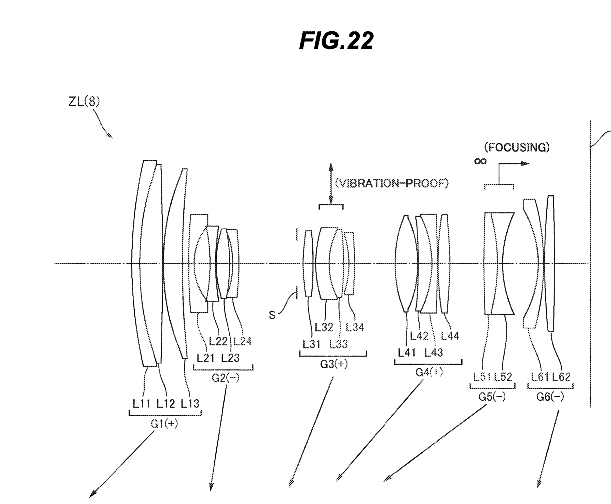

# NIKKOR Z 24-200mm f/4-6.3 VR 光学原理调研

> 项目：Mirrorless Zoom Optics Lab / 微单变焦镜头中镜组成像与变焦对焦原理演示
> 分支：`dsh-dev`
> 调研日期：2026-10-19
> 研究对象：尼康 NIKKOR Z 24-200mm f/4-6.3 VR
> 结论：资料足以支撑**教学演示级**的镜头侧视、逐面折射、六组变焦、G5 内对焦与 VR 原理演示；不足以支撑**生产级光学复刻**。

---

## 0. 先给结论

### 0.1 是否足够支撑项目

**足够，但必须区分“可核实的真实资料”和“为了演示而做的合理近似”。**

| 项目需求 | 资料情况 | 判断 |
|---|---|---|
| 19 片 15 组侧视模型 | 官方规格和官方结构图给出 19 片 15 组；专利实施例 8 给出完整六组、19 片处方 | 可以 |
| 每片镜片模拟光线折射 | 专利给出 35 个面的半径、厚度、折射率、阿贝数和 3 个非球面系数 | 可以做示意性二维追迹 |
| 变焦时哪些镜片移动 | 专利明确所有六组均移动，G3/G6/光圈一体；有 4 个变焦锚点的间隔数据 | 可以 |
| 手动对焦 / 自动对焦 | 官方手册说明控制环、IF、STM；专利给出 G5 对焦组和近距移动量 | 原理可以，控制律需简化 |
| 镜片分组和类型标注 | 官方给出 ED / 非球面 / 非球面 ED 的数量；专利给出每片形状和部分非球面 | 分组可以，逐片类型部分需标注“推断” |
| 详细原理讲解 | 官方术语表 + 专利 + 标准几何光学可以支撑 | 可以 |
| 科普视频 | 侧视、光线、组运动、对焦、VR 都有可视觉化素材 | 可以，后续写脚本 |
| 生产级精确复刻 | 没有公开的量产处方、凸轮曲线、玻璃牌号、口径和实测像差 | 不可以，也不应声称 |

### 0.2 建议的叙事定位

> “基于尼康公开专利实施例与官方规格的**教学示意模型**，不是尼康官方光学仿真，也不是量产镜头的精确 CAD。”

这句话建议同时出现在网页的“关于/数据说明”中和后续科普视频的注释里。

### 0.3 本文件的可信度标记

| 标记 | 含义 |
|---|---|
| 【官方】 | 尼康官网、官方手册、官方术语表直接陈述 |
| 【专利】 | 专利文本、专利附图、专利表格直接给出 |
| 【推导】 | 由专利数据计算得到，例如组位置、移动量、焦距复算 |
| 【推断】 | 用光学原理对“为什么这样设计”的解释，不是尼康官方逐条说明 |

---

## 1. 官方可核实事实

### 1.1 核心规格

来源：尼康全球产品页、尼康日本规格页、官方镜头手册。

| 项目 | 数据 |
|---|---|
| 卡口 | Nikon Z |
| 焦距 | 24–200 mm |
| 最大光圈 | f/4–6.3 |
| 最小光圈 | f/22（24 mm）– f/36（200 mm） |
| 镜头结构 | **19 片 15 组** |
| 特殊镜片 | 2 片 ED、1 片非球面 ED、2 片非球面 |
| 视角 | FX：84°–12°20′；DX：61°–8° |
| 对焦方式 | IF（内对焦） |
| 最近对焦距离 | 24 mm：0.5 m；35 mm：0.54 m；50 mm：0.55 m；70 mm：0.58 m；105 mm：0.65 m；135 mm：0.68 m；200 mm：0.7 m |
| 最大放大倍率 | 0.28×（200 mm） |
| 光圈叶片 | 7 片，圆形光圈 |
| 光圈机构 | 电磁光圈 |
| 防抖 | 镜头位移式 VR，VCM 驱动，CIPA 5.0 档 |
| 滤镜口径 | 67 mm |
| 尺寸 | 约 76.5 mm × 114 mm |
| 重量 | 约 570 g |
| 镀膜 | ARNEO、氟涂层、SIC |
| 卡口材质 | 铝合金 |

### 1.2 官方技术标签及其含义

来源：尼康 NIKKOR 镜头术语表、官方手册。

| 标签 | 官方含义 | 对本项目的意义 |
|---|---|---|
| **IF** | Internal Focusing，内部对焦；只移动镜组内部的对焦组，镜头总长不变 | 演示对焦时镜筒长度不变，只有 G5 前后移动 |
| **STM** | Stepping Motor，步进马达；脉冲驱动，响应和停止可控，安静 | 自动对焦和手动对焦最终都通过 STM 驱动对焦组 |
| **VR** | 镜头位移式防抖；VR 传感器检测抖动，VR 镜组持续运动，抵消像面位移 | 演示 G3 内防抖子组横向移动 |
| **M/A** | 手动优先自动；转动对焦环/控制环可从 AF 几乎无延迟切到 MF | 可做“自动对焦后手动微调”的交互 |
| **ED** | Extra-low Dispersion，低色散玻璃；抑制色差和二级光谱 | 解释前组两片黄色镜片为什么重要 |
| **AS** | Aspherical，非球面；连续改变曲率，校正畸变、彗差、球差 | 解释广角端畸变和边缘彗差 |
| **ASED** | Aspherical ED，非球面低色散；一片同时承担 ED 和非球面两种校正 | 解释“为什么能少用镜片还保持画质” |
| **ARNEO** | 针对垂直入射光的高效抗反射镀膜 | 解释鬼影/眩光，不是成像光路必需，但影响真实感 |
| **E** | 电磁光圈；镜头内置驱动，机身电信号控制 | 演示光圈叶片和景深 |

### 1.3 官方结构图说明了什么

官方镜头页提供了一张 19 片 15 组的侧视结构图，并用颜色区分：

- 黄色：ED 玻璃；
- 橙色：非球面；
- 蓝色：非球面 ED。

官方图没有标出六组的编号，也没有标出变焦/对焦时各组怎么移动。它适合作为“外观和镜片数量”的权威底图，但不能单独支撑运动学演示。

官方结构图：<https://imaging.nikon.com/imaging/lineup/lens/z-mount/z_24-200mmf4-63_vr/>

### 1.4 Z 卡口为什么影响这支镜头的设计

尼康官方 FAQ 给出：Z 卡口内径 **55 mm**，法兰距 **16 mm**。官方开发者访谈进一步说明：

- 短法兰距 + 大卡口让后组可以做得更大、前组可以做得更小；
- 镜头重心可以更靠近机身；
- 这是 24-200 mm 在 570 g 级别实现较高画质的重要前提。

这解释了专利结构里 G6 后组口径较大、G1 前组相对收敛的形态。

---

## 2. 关键证据：专利实施例 8

### 2.1 专利身份

| 项目 | 内容 |
|---|---|
| 美国公开号 | US20220121021A1 |
| 美国授权号 | US12366737B2 |
| 日本授权号 | JP7120330B2 |
| PCT 公开号 | WO2020157904A1 |
| 申请/优先权日 | 2019-01-31 |
| 申请人 | Nikon Corporation |
| 发明人 | Makida Ayumu、Ito Tomoki、Miwa Satoshi |
| 标题 | Zoom optical system, optical apparatus and method for manufacturing the zoom optical system |
| 本文件采用的实施例 | **第八实施例（Example 8）** |

本地留存：

- [US20220121021A1.pdf](raw/US20220121021A1.pdf)
- [US20220121021A1_full.txt](raw/US20220121021A1_full.txt)
- [专利 FIG.22：实施例 8 的六组结构](assets/patent-us20220121021-fig22.png)

> 专利文本和专利附图属于美国专利公开文献；本地留档用于研究与教学，不包含尼康量产 CAD 数据。

### 2.2 为什么说实施例 8 很可能接近量产 24-200

| 对照项 | 专利实施例 8 | 量产 NIKKOR Z 24-200 |
|---|---|---|
| 镜片数 / 组数 | 19 片 / 15 组 | **19 片 / 15 组** |
| 组结构 | 正-负-正-正-负-负 六组 | 与官方结构图的六段形态一致 |
| 焦距 | 24.70–194.00 mm | 24–200 mm |
| 最大光圈 | f/4.12–6.49 | f/4–6.3 |
| 变焦比 | 7.854× | 8.33× |
| 对焦 | G5 向像方移动，IF | 官方明确 IF |
| 防抖 | G3 内胶合子组横向移动 | 官方明确镜头位移 VR |

**判断：**实施例 8 与量产镜头在“片数、组数、组光焦度排列、对焦组位置”上高度吻合，镜片形状也与官方结构图高度相似，是公开资料中最适合做代理模型的处方。
**但不能说它就是量产处方：**焦距 194 mm 对 200 mm、光圈 f/6.5 对 f/6.3，说明量产版至少做了重新优化或不同实施例。网页和视频里应写“专利实施例近似”，不能写“尼康官方光路”。

### 2.3 实施例 8 的六组结构



图中从物体侧（左）到像面（右）：

```text
物体 → G1(+) → G2(−) → S → G3(+) → G4(+) → G5(−) → G6(−) → 像面
```

| 组 | 片数 / 组数 | 光焦度 | 专利焦距 | 变焦运动 | 对焦运动 | 功能（推断） | 为什么需要 |
|---|---:|---|---:|---|---|---|---|
| **G1** | 3 / 2 | 正 | +99.95 mm | 向物方，行程最大 | 不动 | 前组聚光、决定视角和入瞳 | 高倍变焦需要强正前组把广角光束收进来，同时控制前口径 |
| **G2** | 4 / 4 | 负 | −15.36 mm | 向物方，行程最小 | 不动 | 主变倍组（variator） | 负组移动改变系统放大率，是 24→200 mm 的主要变焦手段 |
| **S** | 光圈 | — | — | 与 G3/G6 一体 | 不动 | 控制光锥、景深、像差平衡 | 放在 G2 后、G3 前，兼顾紧凑和后续大后组 |
| **G3** | 4 / 3 | 正 | +40.04 mm | 向物方 | 不动；内部 VR 子组横移 | 补偿/中继组；VR 组 | 抵消 G2 移动造成的像面漂移，并承担防抖 |
| **G4** | 4 / 3 | 正 | +30.84 mm | 向物方，行程大于 G3 | 不动 | 中继/像差补偿组 | 与 G3 做相对运动，抑制变焦中的球差和场曲 |
| **G5** | 2 / 1 | 负 | −50.14 mm | 向物方，内部行程最大 | **向像方移动** | 对焦组兼补偿组 | 轻量负胶合组，移动小、速度快，实现 IF |
| **G6** | 2 / 2 | 负 | −238.47 mm | 与 G3/G6 块一起向物方 | 不动 | 后组场曲/后焦校正 | 负后组帮助平场、控制后焦，配合大卡口后组口径 |

> “功能”列是光学原理解释，不是尼康官方逐组说明。专利只直接给出组光焦度、镜片构成、运动关系和部分条件式。

### 2.4 变焦运动学：谁在动，怎么动

#### 2.4.1 四个变焦锚点的空气间隔

专利表 8 的无限远对焦数据（单位 mm）：

| 状态 | f | D1 | D2 | D3 | D4 | D5 | BF |
|---|---:|---:|---:|---:|---:|---:|---:|
| W（广角） | 24.70 | 1.500 | 15.497 | 10.635 | 8.897 | 9.312 | 9.300 |
| M1 | 50.00 | 18.292 | 10.237 | 4.971 | 4.434 | 19.439 | 20.643 |
| M2 | 105.00 | 34.705 | 4.559 | 1.814 | 5.196 | 21.833 | 36.833 |
| T（长焦） | 194.00 | 54.284 | 1.500 | 1.500 | 1.511 | 25.833 | 40.300 |

其中：

- D1：G1 后表面到 G2 前表面；
- D2：G2 后表面到光圈；
- D3：G3 后表面到 G4 前表面；
- D4：G4 后表面到 G5 前表面；
- D5：G5 后表面到 G6 前表面；
- BF：G6 后表面到像面。

#### 2.4.2 关键机构结论

1. **六组全都移动。**专利明确：从广角到长焦，G1、G2、S、G3、G4、G5、G6 都沿光轴移动，相邻组间隔变化。
2. **G3、G6 和光圈是一个整体运动块。**专利明确“光圈 S、G3、G6 一体移动”。
3. **这个整体块的内部长度恒定。**由表 8 可算：

   ```text
   D3 + D4 + D5 = 28.844 mm（四个状态都相同）
   ```

   因此 G3 第一面到 G6 第一面的距离也恒定，约 61.84 mm。
4. **G4 和 G5 在这个块内部做相对运动。**D4 不是单调变化（8.897 → 4.434 → 5.196 → 1.511），说明 G4/G5 的相对运动有“先靠近、再稍微分开、最后再靠近”的过程。做动画时不能简单用直线插值。
5. **所有组都向物方移动，但行程差别很大。**G1 向前伸出最多，G2 最少；G3/G6 块中等；G4/G5 在块内追赶。

#### 2.4.3 以像面为原点的组位置

把像面设为 0，物体侧为负，由表 8 的 TL、D 值和组厚度反推（单位 mm）：

| 状态 | G1 前表面 | G2 前表面 | G3 前表面 | G4 前表面 | G5 前表面 | G6 前表面 |
|---|---:|---:|---:|---:|---:|---:|
| W | −120.46 | −105.57 | −75.39 | −51.26 | −27.82 | −13.56 |
| M1 | −143.34 | −111.66 | −86.74 | −68.27 | −49.29 | −24.90 |
| M2 | −170.26 | −122.17 | −102.93 | −87.61 | −67.87 | −41.09 |
| T | −190.25 | −122.57 | −106.39 | −91.39 | −75.34 | −44.56 |

从广角到长焦的绝对移动量：

| 组 | 移动量 | 方向 |
|---|---:|---|
| G1 | −69.79 mm | 向物方 |
| G2 | −17.00 mm | 向物方 |
| G3 / G6 块 | −31.00 mm | 向物方 |
| G4 | −40.13 mm | 向物方 |
| G5 | −47.52 mm | 向物方 |

> 这些数值是【推导】，用于动画锚点非常合适；量产镜头的真实凸轮曲线可能略有不同。

### 2.5 对焦：G5 内对焦

#### 2.5.1 哪个组在动

专利明确：

> “通过将第五透镜组 G5 向像面 I 侧移动，实现从远距离物体到近距离物体的对焦。”

也就是说：

- 对焦组是 **G5**，由 L51 + L52 胶合而成；
- 对焦时 G5 向像方（靠近传感器）移动；
- 镜头总长不变，属于 **IF（内对焦）**；
- 对焦组只有两片胶合，质量小，适合 STM 快速驱动。

#### 2.5.2 对焦行程

专利表 8 同时给出无限远和近距离两组 D4/D5。G5 的移动量等于 D4 的增加量，也等于 D5 的减少量：

| 状态 | f | 无限远 D4 | 近距 D4 | G5 向像方移动 |
|---|---:|---:|---:|---:|
| W | 24.70 | 8.897 | 10.204 | **1.31 mm** |
| M1 | 50.00 | 4.434 | 7.936 | **3.50 mm** |
| M2 | 105.00 | 5.196 | 10.799 | **5.60 mm** |
| T | 194.00 | 1.511 | 11.045 | **9.53 mm** |

这说明：

- 广角端对焦行程很短，长焦端明显变长；
- 对焦组移动量随焦距增大而增大，动画里不能用一个固定位移；
- 近距对焦时 G6 不动，G5 单独向像方移动；真实镜头再由对焦闭环把像面稳定在传感器上。

#### 2.5.3 官方手动/自动对焦行为

官方手册说明：

- 镜头上有 **变焦环** 和 **控制环**，没有独立的“对焦环”；
- 在 MF 模式下，旋转 **控制环** 进行对焦；
- 在 AF 模式下，控制环可被机身分配为“对焦（M/A）”或“光圈”等功能；
- 镜头没有 AF/MF 切换开关，需要通过机身菜单切换；
- 镜头没有 VR 开关，需要通过机身菜单控制；
- 对焦方式为 IF，防抖为镜头位移 VCM。

**关于 focus-by-wire：**官方手册没有直接写“focus-by-wire”，但从“控制环 + STM + 无机械离合”的结构看，应把 MF 视为电子对焦：控制环转动产生编码信号，机身/镜头驱动 STM 移动 G5。演示中可以这样解释，文案上建议写“电子控制的手动对焦”，不要写成“机械直连”。

#### 2.5.4 自动对焦演示可以怎么讲

真实尼康 Z 相机的 AF 涉及机身传感器、相位/对比度检测、被摄体识别、镜头马达和镜头位置反馈。网页不需要复刻算法，可以做一个“教学级闭环”：

```text
目标距离 → 当前像面误差 → AF 控制器 → STM 指令 → G5 移动 → 新像面误差 → …
```

可演示：

- AF-S：一次驱动，合焦后停；
- AF-C：持续采样，追焦；
- 手动：控制环输入 → G5 位置；
- 变焦中 AF：焦距变化后重新计算 G5 目标位置。

**注意：**这是原理演示，不是尼康真实 AF 算法的复刻。

#### 2.5.5 焦点呼吸与“变焦时追焦”

官方强调：

- 对焦时抑制 focus breathing（画角变化）；
- 变焦时保持对被摄体的 AF 追焦；
- 不能据此说这支镜头是严格“齐焦（parfocal）”；官方没有这样定义。

演示时可以把“变焦后焦点轻微漂移 → AF 重新校正”做成一个可观察现象，而不是承诺完全无漂移。

### 2.6 防抖：G3 内部的 VR 子组

专利实施例 8 明确：

- G3 中的 **L32 + L33 胶合组** 是防抖组；
- 该组具有正光焦度；
- 防抖时沿垂直于光轴的方向移动；
- 通过横向移动补偿相机抖动造成的像面位移。

官方补充：

- 使用 **VCM（音圈马达）** 驱动镜头位移；
- CIPA 标准下 5.0 档（200 mm 端）；
- VR 模式 NORMAL / SPORT；
- 与机身 VR 配合可实现 5 轴补偿；
- 镜头关闭防抖时可能听到内部组件轻微晃动，这是正常现象。

**演示建议：**让 G3 的 L32+L33 子组做小幅横向平移（示意幅度，非官方实测值），同时像面上的点保持稳定；不要把它画成整组 G3 平移。

### 2.7 光圈

- 光圈 S 位于 G2 与 G3 之间；
- 专利中 S 与 G3、G6 一起移动；
- 7 片圆形光圈；
- 24 mm 最大 f/4，200 mm 最大 f/6.3；
- 电磁光圈，由机身电信号控制。

演示中光圈不只是“变亮变暗”，还会影响：

- 光线锥角；
- 景深；
- 球差/彗差的表现；
- 衍射（真实镜头在小光圈下）。

教学模型可以先只做几何光锥和景深，衍射作为可选解释层。

---

## 3. 镜片分类与“为什么需要”

### 3.1 按组分类：六组各自解决什么问题

| 组 | 角色 | 主要像差/功能 | 如果去掉会怎样 |
|---|---|---|---|
| G1 | 前组聚光 | 视角、入瞳、广角端彗差/场曲、色差 | 广角收不进来，前口径变大，色差明显 |
| G2 | 主变倍组 | 改变放大率；广角畸变、彗差 | 无法从 24 变到 200，或需要极大移动量 |
| G3 | 补偿/中继 + VR | 稳定像面、球差、色差；防抖 | 变焦时像面漂移，防抖无从实现 |
| G4 | 中继/像差补偿 | 球差、场曲、彗差；与 G3 做相对运动 | 长焦端画质下降，变焦像差压不住 |
| G5 | 对焦组 | 改变物距共轭；对焦引起的色差/球差 | 只能整组前伸对焦，速度慢、呼吸大 |
| G6 | 后组场曲/后焦 | 平场、后焦、边缘画质 | 边缘场曲大，后焦难匹配 Z 卡口 |

### 3.2 按材料/工艺分类

官方给出的类型数量：

- 2 片 ED；
- 1 片非球面 ED；
- 2 片非球面；
- ARNEO 镀膜；
- 前片氟涂层；
- SIC 多层镀膜。

**计数口径提醒：**官方文字把“非球面 ED”与“ED”“非球面”并列，类型数量不一定等于物理镜片数；同一片非球面 ED 可能同时被计入“ED”和“非球面”类别。官方结构图中可辨认的着色镜片为：

- 前组 2 片黄色（ED）；
- G4 区域 1 片橙色（非球面）；
- G5 区域 1 片蓝色（非球面 ED）。

因此网页上建议同时给出两种信息：

1. 官方文字数量（2 ED、1 ASED、2 AS）；
2. 结构图可辨认的着色位置（前组两片 ED、后部一片 AS、一片 ASED）。

这样既不丢官方数据，也不会把“类型计数”误画成“5 片独立特殊镜片”。

### 3.3 逐片功能表（基于实施例 8，作用为光学解释）

> 面号来自专利表 8；`*` 表示该面为非球面。
> “类型”列中，ED 的位置有官方结构图支持；AS/ASED 的逐片对应关系属于推断，开发时应保留“待核对”标记。

| 编号 | 组 | 面号 | 形状 | nd / νd | 类型（推断） | 作用（推断） |
|---|---|---|---:|---|---|---|
| L11 | G1 | 1–2 | 负弯月 | 1.9020 / 25.26 | — | 前组负弯月；控制前口径、广角彗差和畸变 |
| L12 | G1 | 2–3 | 双凸 | 1.4978 / 82.57 | **ED-1** | 前组主正光焦度；低色散，压轴向色差 |
| L13 | G1 | 4–5 | 正弯月 | 1.5932 / 67.90 | **ED-2** | 前组场曲/彗差校正；低色散 |
| L21 | G2 | 6–7 | 负弯月 | 1.8160 / 46.59 | AS 候选 | 变倍组前片；广角端畸变/彗差校正 |
| L22 | G2 | 8–9 | 双凹 | 1.8485 / 43.79 | — | 变倍组主负光焦度 |
| L23 | G2 | 10–11 | 双凸 | 1.8081 / 22.74 | — | 变倍组内正片；平衡色差/球差 |
| L24 | G2 | 12–13 | 负弯月 | 1.8485 / 43.79 | — | 变倍组后片；控制出瞳和场曲 |
| L31 | G3 | 15–16 | 双凸 | 1.7440 / 44.85 | — | 补偿组前正片；收束光圈后光束 |
| L32 | G3 | 17–18 | 负弯月 | 1.9408 / 30.99 | VR 组前片 | 与 L33 胶合，构成横向移动的防抖组 |
| L33 | G3 | 18–19 | 双凸 | 1.5088 / 59.70 | VR 组后片 | 给防抖组正光焦度；色差校正 |
| L34 | G3 | 20–21 | 负弯月 | 1.7301 / 29.68 | — | 补偿组后片；场曲/彗差平衡 |
| L41 | G4 | 22–23 | 双凸 | 1.4875 / 70.40 | — | 后组前正片；中继光焦度 |
| L42 | G4 | 24–25 | 正弯月 | 1.5075 / 68.30 | — | 与 L43 胶合；色差校正 |
| L43 | G4 | 25–26 | 负弯月 | 1.9102 / 32.03 | — | 与 L42 胶合；色差/场曲校正 |
| L44 | G4 | 27–28* | 双凸 | 1.6111 / 59.13 | **AS** | 后组正片；非球面校正球差/彗差 |
| L51 | G5 | 29–30 | 双凸 | 1.8081 / 22.74 | — | 对焦组前片 |
| L52 | G5 | 30–31* | 双凹 | 1.7440 / 44.82 | **ASED 候选** | 对焦组后片；非球面/低色散，抑制对焦像差 |
| L61 | G6 | 32–33 | 负弯月 | 1.5312 / 66.16 | — | 后组场曲校正 |
| L62 | G6 | 34–35 | 双凸 | 1.7498 / 27.80 | — | 后组正片；与 L61 之间形成空气透镜，校正场曲 |

**关于 L21 和 L52 的特别说明：**

- 专利实施例 8 在 S6、S28、S31 三个面使用非球面；对应 L21、L44、L52。
- 官方结构图只明确着色了两片非球面（G4 橙、G5 蓝）和两片 ED（前组黄）。
- 因此 L21 是否在量产版保留非球面、L52 是否就是官方所说的“非球面 ED”，需要开发时以官方图/更多专利核对。
- 网页上可把 L21 标为“专利非球面（量产待核对）”，把 L52 标为“非球面 ED（推断）”，避免把推断说成定论。

### 3.4 为什么高倍变焦必须“分工”

一支 8.3× 全画幅变焦镜头同时要满足：

- 24 mm 广角；
- 200 mm 长焦；
- f/4–6.3；
- 570 g；
- 视频对焦呼吸小；
- 近摄 0.5–0.7 m；
- 还能加 VR。

这不可能由一组镜片完成。六组的分工本质上是把矛盾拆开：

1. **G1 负责“收光”**：把广角大角度光线收进系统，同时不把前口径做得太大。
2. **G2 负责“变倍”**：负组移动最直接地改变放大率。
3. **G3/G4 负责“补偿和修像差”**：G2 一动，像面就会漂；G3/G4 用不同行程把像面拉回来，同时压球差、场曲、彗差。
4. **G5 负责“对焦”**：只动两片小胶合组，速度快、声音小、镜筒不变长。
5. **G6 负责“平场和后焦”**：后组负光焦度帮助边缘光线落回像面，配合 Z 卡口的大后组。
6. **S 负责“限光”**：位置和口径影响景深、像差和体积。

这也是为什么“镜片多”不等于“堆料”：每一组都在解决另一组制造出来的问题。

---

## 4. 给后续开发的具体建议

### 4.1 建议采用的光学模型

**建议：用专利实施例 8 的处方作为“代理模型”，用官方规格做 UI 标尺。**

具体做法：

1. **面数据**：使用本文附录 A 的 35 个面（R、D、nd、νd）。
2. **非球面**：S6、S28、S31 使用专利系数；如果只做近轴/示意，可以先忽略非球面偏离，只保留球面曲率。
3. **光线追迹**：二维子午面，逐面用 Snell 定律折射；光圈处裁剪；像面固定。
4. **变焦**：用 4 个锚点（24.7 / 50 / 105 / 194 mm）的组位置做单调插值；**不要对 D4 做直线插值**，因为它非单调。
5. **对焦**：在变焦插值结果上，给 G5 叠加一个向像方的位移；位移量按 1.31–9.53 mm 的对焦行程缩放。
6. **VR**：只让 G3 的 L32+L33 子组横向平移，不要整组 G3 平移。
7. **光圈**：用可变光阑半径控制光线锥；同时显示 f-number 和景深提示。
8. **归一化**：UI 上把 24.7→24、194→200 做端点映射；在“数据说明”里保留专利真实值。

**已做的数值校验：**用实施例 8 的 R/D/nd 做近轴逐面追迹，计算得到 EFL = 24.70 / 50.00 / 105.00 / 194.00 mm，与专利表 8 的 f 值一致（误差 < 0.01 mm）。这说明处方和间隔数据是自洽的，适合做教学模型。

### 4.2 网页交互的最小完整形态

建议首屏就是一个“可操作的镜头侧视工作台”，而不是先放长文：

- 主视图：19 片镜片侧视 + 光轴 + 光线 + 像面；
- 变焦滑杆：24–200 mm，实时移动六组；
- 对焦滑杆 / AF 按钮：G5 前后移动，像面点由虚变实；
- VR 开关：G3 子组横向微移，像面点保持稳定；
- 光圈滑杆：光锥收放，景深提示变化；
- 组标签：G1–G6、S、像面；
- 类型标签：ED、AS、ASED、VR、对焦组；
- 点击任一组/片：侧边解释“它解决什么问题、去掉会怎样”；
- “数据说明”入口：说明专利代理模型、非官方、非量产 CAD。

### 4.3 建议的数据分层

| 数据 | 用途 | 来源/可信度 |
|---|---|---|
| 镜头规格、MFD、光圈、重量 | 顶部参数和文案 | 官方 |
| 19 片 15 组、特殊类型数量 | 结构总览 | 官方 |
| 35 面 R/D/nd/νd | 逐面追迹 | 专利实施例 8 |
| 3 个非球面系数 | 非球面形状 | 专利实施例 8 |
| 六组光焦度、焦距 | 组标签和解释 | 专利 |
| 4 个变焦锚点 D 值 | 变焦动画 | 专利 |
| 组绝对位置/移动量 | 动画轨迹 | 由专利推导 |
| G5 对焦行程 | 对焦动画 | 由专利推导 |
| VR 子组 | 防抖演示 | 专利 + 官方 VCM |
| 每片 ED/AS/ASED 对应 | 类型标签 | 官方图 + 推断，需标注 |

### 4.4 简化边界（必须在 UI/视频里说明）

教学模型会做以下简化：

- 二维子午面，不是完整三维光线；
- 近轴/几何光学，不含衍射、杂散光、镀膜光谱；
- 只用 nd/νd，不含真实玻璃的部分色散曲线；
- 非球面只保留专利系数，量产版可能不同；
- 口径是估算的，不是量产机械口径；
- 凸轮曲线用 4 个锚点插值，不是真实凸轮；
- AF/VR 控制是教学闭环，不是尼康算法；
- 不含公差、热漂移、装配误差、马达非线性。

因此：

- 可以说“基于公开专利的示意光路”；
- 不能说“尼康官方光路”；
- 不能说“量产镜头精确仿真”；
- 不能把动画里的合焦/防抖当成真实性能证明。

---

## 5. 资料充分性评估

| 需求 | 支撑程度 | 结论 |
|---|---|---|
| 19 片 15 组侧视 | 官方 + 专利 | 足够 |
| 每片镜片形状和折射 | 专利处方完整 | 足够做示意追迹 |
| 非球面 | 专利 3 个面系数 | 足够做形状；量产对应需核对 |
| 六组变焦运动 | 专利明确 + 4 锚点 | 足够做动画 |
| G3/G6/光圈一体 | 专利明确 + D 值可验证 | 足够 |
| G5 内对焦 | 专利明确 + 近距 D 值 | 足够 |
| 手动对焦 | 官方控制环 + STM；focus-by-wire 为推断 | 行为足够，控制律需简化 |
| 自动对焦 | 官方 AF 行为 + 通用闭环 | 原理足够，算法不复刻 |
| VR | 专利子组 + 官方 VCM/5 档 | 足够 |
| 镜片类型标注 | 官方数量 + 图示颜色；逐片部分推断 | 足够做“近似标注”，需透明说明 |
| 详细原理讲解 | 官方术语 + 专利 + 标准光学 | 足够 |
| 生产级精确复刻 | 无公开量产处方/凸轮/口径/实测 | 不足，不应承诺 |

**总评：**对“演示项目”是 **A-/B+ 级资料充分度**；对“光学工程复刻”是 **C 级**。当前资料已经足够开始搭建第一版，但要把“代理模型”的边界写进产品。

---

## 6. 仍缺的资料与下一步

1. **更接近量产的专利/实施例**：继续检索尼康 2019–2021 年变焦专利，找 f/4–6.3、200 mm 端、19 片 15 组的对应实施例。
2. **真实凸轮/机械布局**：拆解或维修资料可以验证 G1/G2/G3/G4/G5/G6 的实际凸轮和马达位置，但属于第三方资料，需标注。
3. **每片玻璃牌号/部分色散**：目前只有 nd/νd；如果要做色散演示，需要更完整的玻璃数据或合理假设。
4. **口径/通光孔径**：专利通常不公开机械口径；需要从结构图估算，或做“示意口径”。
5. **实测像差/MTF/畸变**：可用于校准教学模型的像差表现，但不应把模拟结果当成实测。
6. **AF/VR 控制细节**：马达扭矩、编码器分辨率、控制周期、VR 补偿范围不公开；教学闭环即可。
7. **官方日文访谈原文**：中文二手访谈已足够支撑设计意图，若要做严谨引用，建议找日文原文。

---

## 7. 来源

### 7.1 官方资料

1. Nikon 全球产品页：NIKKOR Z 24-200mm f/4-6.3 VR
   <https://imaging.nikon.com/imaging/lineup/lens/z-mount/z_24-200mmf4-63_vr/>
2. Nikon 日本规格页（含 IF、VR VCM、MFD 分档）
   <https://nij.nikon.com/products/lineup/nikkor/zmount/nikkor_z_24-200mm_f4-63_vr/spec.html>
3. Nikon 官方镜头手册（控制环、VR、IF、无 AF/MF 开关）
   <https://onlinemanual.nikonimglib.com/z5/en/16_kit_lens_manual_02.html>
4. Nikon NIKKOR 镜头术语表（ED、AS、ASED、IF、VR、STM、E、M/A）
   <https://imaging.nikon.com/imaging/lineup/lens/glossary/>
5. Nikon Z 卡口 FAQ（内径 55 mm、法兰距 16 mm）
   <https://nij.nikon.com/support/faq/products/article?articleNo=000056478>
6. Nikon 日本产品特征页（ARNEO、ED、非球面、VR、视频性能）
   <https://nij.nikon.com/products/lineup/nikkor/zmount/nikkor_z_24-200mm_f4-63_vr/features01.html>

### 7.2 专利

7. US20220121021A1（Google Patents）
   <https://patents.google.com/patent/US20220121021A1/en>
8. JP7120330B2（日本授权）
   <https://patents.google.com/patent/JP7120330B2/en>
9. WO2020157904A1（PCT 公开）
   <https://patents.google.com/patent/WO2020157904A1/en>

### 7.3 访谈与背景

10. 蜂鸟网：尼克尔 Z 24-200mm 开发者访谈（STM、对焦呼吸、VR、Z 卡口后组）
    <https://m.fengniao.com/document/5362611.html>
11. 蜂鸟网：尼康三支高倍率变焦专利报道（专利号、实施例参数）
    <https://qicai.fengniao.com/537/5370219.html>

### 7.4 通用光学背景（可选）

12. University of Arizona, “Zoom lenses” 讲义 PDF（变焦系统、补偿组等基础概念）
    <http://wp.optics.arizona.edu/jsasian/wp-content/uploads/sites/33/2018/10/Zoom_1.pdf>

---

## 8. 附录

### 附录 A：实施例 8 的 35 面处方

> 单位：mm；`D` 为到下一面的轴向距离；`*` 为非球面；`D1–D5`、`BF` 为随变焦/对焦变化的间隔。
> 数据来源：US20220121021A1 表 8。

| 面 | R | D | nd | νd |
|---:|---:|---:|---:|---:|
| 1 | 119.2532 | 2.0000 | 1.902000 | 25.26 |
| 2 | 75.4740 | 6.1889 | 1.497820 | 82.57 |
| 3 | −685.9404 | 0.1000 | — | — |
| 4 | 62.0223 | 5.1009 | 1.593190 | 67.90 |
| 5 | 237.4793 | D1 | — | — |
| 6* | 153.6662 | 1.5000 | 1.816000 | 46.59 |
| 7 | 15.5464 | 4.2474 | — | — |
| 8 | −40.2333 | 1.5002 | 1.848500 | 43.79 |
| 9 | 79.6309 | 0.1006 | — | — |
| 10 | 32.2669 | 3.5980 | 1.808090 | 22.74 |
| 11 | −38.3529 | 0.7346 | — | — |
| 12 | −22.0127 | 1.5000 | 1.848500 | 43.79 |
| 13 | −91.6465 | D2 | — | — |
| 14 | ∞ | 1.5000 | — | — |
| 15 | 44.5290 | 2.6559 | 1.743972 | 44.85 |
| 16 | −81.3774 | 0.7000 | — | — |
| 17 | 33.2106 | 3.4046 | 1.940752 | 30.99 |
| 18 | 19.5338 | 3.9016 | 1.508752 | 59.70 |
| 19 | −65.3422 | 1.3372 | — | — |
| 20 | −26.7545 | 1.5000 | 1.730111 | 29.68 |
| 21 | −101.6153 | D3 | — | — |
| 22 | 33.1030 | 6.1030 | 1.487502 | 70.40 |
| 23 | −28.7765 | 0.1000 | — | — |
| 24 | −116.0123 | 3.4598 | 1.507497 | 68.30 |
| 25 | −28.0491 | 1.5000 | 1.910214 | 32.03 |
| 26 | −237.5876 | 0.2542 | — | — |
| 27 | 95.5133 | 3.1295 | 1.611115 | 59.13 |
| 28* | −51.7400 | D4 | — | — |
| 29 | 333.8201 | 3.4464 | 1.808090 | 22.74 |
| 30 | −49.9705 | 1.5000 | 1.743986 | 44.82 |
| 31* | 31.2247 | D5 | — | — |
| 32 | −27.4502 | 1.5000 | 1.531180 | 66.16 |
| 33 | −59.8926 | 0.1000 | — | — |
| 34 | 164.9552 | 2.6581 | 1.749763 | 27.80 |
| 35 | −519.6427 | BF | — | — |

非球面系数（专利表 8）：

| 面 | κ | A4 | A6 | A8 | A10 | A12 |
|---:|---:|---:|---:|---:|---:|---:|
| 6 | 1.0000 | 2.54661E−06 | 1.57681E−08 | −1.62633E−10 | 6.99665E−13 | 0 |
| 28 | 1.0000 | 2.83706E−05 | −3.41484E−08 | 2.83345E−10 | −4.50609E−13 | 0 |
| 31 | 1.0000 | −4.24770E−06 | 6.21761E−08 | −2.79037E−10 | 4.34156E−13 | 0 |

### 附录 B：组位置推导方法

以第一面为 0，按面厚度累加，可得各组第一面的相对位置：

```text
G2 = G1 + t(G1) + D1
G3 = G2 + t(G2) + D2 + t(光圈)
G4 = G3 + t(G3) + D3
G5 = G4 + t(G4) + D4
G6 = G5 + t(G5) + D5
```

再把 G1 第一面放在 `−TL`（像面为 0），即可得到正文中的绝对位置表。该推导只依赖专利表 8 的几何数据，不依赖具体镜片材料。

### 附录 C：术语速查

| 术语 | 解释 |
|---|---|
| 变倍组 / variator | 主要负责改变焦距/放大率的组；本设计中是 G2 |
| 补偿组 / compensator | 负责把变倍后漂移的像面拉回来的组；本设计中 G3/G4/G5/G6 都参与 |
| 对焦组 | 负责改变物距共轭的组；本设计中是 G5 |
| 内对焦 IF | 对焦时镜头总长不变，只移动内部组 |
| 齐焦 / parfocal | 变焦后焦点基本不漂；官方没有把本镜头定义为严格齐焦 |
| 焦点呼吸 | 对焦时画角变化；官方称已抑制 |
| 场曲 | 像面不是平面，边缘对焦位置与中心不同 |
| 彗差 | 轴外点成像呈彗星状拖尾 |
| 球差 | 轴上点不同孔径光线焦点不一致 |
| 色差 | 不同波长焦点/放大率不同，表现为紫边/绿边 |
| 二级光谱 | 校正了初级色差后仍残留的波长相关误差；ED 玻璃重点解决 |

### 附录 D：版权与使用边界

- **专利文本/附图**：美国专利公开文献，本文留档用于研究与教学；专利附图已标注来源。
- **尼康官网/手册**：受版权保护。本文只引用有限事实、数据和链接，不复制手册全文或整页营销图。
- **官方结构图**：建议在网页中链接官方页面，或由项目自行重绘；不要直接搬运官方营销图作为产品素材。
- **第三方访谈**：引用观点时注明来源；不要大段翻译转载。
- **商标**：可在“兼容对象/研究案例”意义上使用 NIKKOR、Nikon 名称，但应注明“非官方、非商业教学演示”，避免暗示尼康背书。

---

## 9. 一句话交接

**下一步可以直接进入“镜头侧视 + 变焦/对焦交互”的第一版原型：用专利实施例 8 的 35 面处方做二维示意追迹，用 4 个变焦锚点驱动六组，用 G5 的对焦行程做 IF 对焦，用 G3 的 L32+L33 子组做 VR；所有画面标注“基于公开专利的示意模型，非量产精确仿真”。**
